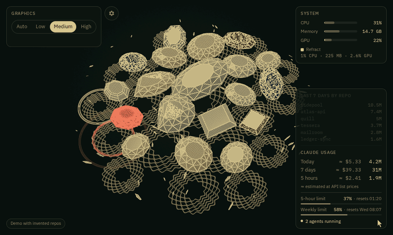
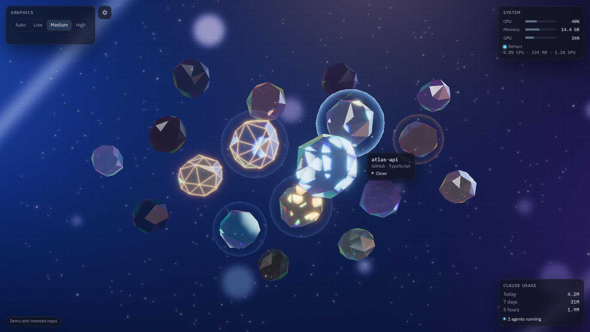

# Refract

A launcher for Claude Code agents. Every repo you work on is a glass gem in one 3D scene; pick one, press Enter, and a bare VS Code window opens on it with `claude` already running in the terminal.

**[Try the web demo](https://maddoxrjohnson.github.io/refract/)** (invented repos; launching only shows a pretend terminal).



## What the gems show

Each repo is a rough-cut glass gem, frozen mid-burst. The heaviest repos sit near the centre.

| You see | It means |
|---|---|
| Size | How big and busy the repo is: repository size blended with commits in the last 30 days |
| Tint | Main language |
| Blue halo | Uncommitted changes |
| Pulsing amber edges | An agent session stopped before it finished |
| Gentle shimmer | An agent is working in the repo right now (needs the status hook) |
| Slow amber pulse | An agent is waiting for your input (needs the status hook) |
| Dimmed | On GitHub or GitLab but not cloned yet |



## Features

- **Win+Alt+Space** shows or hides Refract from anywhere; it lives in the tray and draws nothing while hidden.
- **Magnet focus:** the gem nearest the pointer lifts and shows its name, host, language and state.
- **Click to zoom** into a gem and see its branch, ahead/behind, changed files, last commit, last agent session, open pull or merge requests and CI status.
- **Enter to launch.** A VS Code window opens in WSL with only a terminal, running a new agent. If the repo is already open, that window comes forward and a new terminal tab opens there with the agent. A repo with an unfinished session asks whether to resume it or start fresh, and preselects the sensible choice.
- **Type to filter** by name; arrow keys move between gems.
- **GitHub and GitLab** repos you haven't cloned appear dimmed; launching one clones it into `~/projects` first.
- **Status hook (optional).** One small script added to Claude Code's settings tells Refract when an agent is working or waiting on you. Removing it restores your settings byte for byte if nothing else changed them since it was installed; otherwise it removes only Refract's entries and leaves the rest alone.
- **Widgets:** system load (with Refract's own share) and Claude Code token use today, over the last 7 days and in the last 5 hours, added up from Claude Code's local session files, with an optional cost estimate at API list prices from a price table you can edit, and the 5-hour and weekly plan-limit percentages when your Claude Code status line relays them to `~/.claude/usage-state.json` (see [plan limits](docs/architecture.md#plan-limits) for the file's format).
- **Graphics levels** (Low, Medium, High) chosen automatically from frame times and how busy the GPU is with other programs.

## How it works

A Tauri app on Windows draws the scene and talks to a small helper inside WSL, which watches your repos and Claude Code's session files with inotify. A VS Code extension sets up the terminal-only window and runs `claude`. [docs/architecture.md](docs/architecture.md) explains the split, and [docs/launch.md](docs/launch.md) covers launching in detail.

## Requirements

- Windows 10 or 11 with WSL 2 (Ubuntu or another distro)
- VS Code on Windows with the WSL extension
- Claude Code installed inside WSL
- Optional: the GitHub CLI (`gh`) logged in, or a token, to list GitHub repos; a token for GitLab

## Install

Download the installer from [Releases](https://github.com/maddoxrjohnson/refract/releases). It is not code-signed yet, so Windows SmartScreen will warn before it runs: choose **More info**, then **Run anyway**.

## Build from source

Everything builds from WSL. The Windows app is cross-compiled with [cargo-xwin](https://github.com/rust-cross/cargo-xwin).

```sh
cargo test                       # the core library, the WSL helper and the launcher
cd app
npm ci
npm test && npm run lint         # interface tests and type checks
npm run test:e2e                 # browser tests of the web demo (Playwright)
npm run tauri:build              # the Windows app (exe only; tagged releases build the installer)
```

The Windows app bundles the Linux helper and installs it into WSL on first run, so build the helper first (in WSL), as a static musl binary, and copy it into the app's resources:

```sh
rustup target add x86_64-unknown-linux-musl
cargo build --release -p refract-agent --target x86_64-unknown-linux-musl
cp target/x86_64-unknown-linux-musl/release/refract-agent app/src-tauri/resources/refract-agent
```

Without that copy `app/scripts/ensure-helper.mjs` writes an empty placeholder so the build still works, and the app then uses a helper that is already installed. For development, set `REFRACT_AGENT` to the path of a helper in WSL to use that instead.

`scripts/dev-app.sh` runs the app in dev mode against a fresh build of the helper.

To use a local build day to day, build the helper (`cargo build --release -p refract-agent`) and the exe, then run `scripts/install-local.sh`. It copies them to `%LOCALAPPDATA%\Programs\Refract`, puts the helper in WSL, adds Start menu and desktop shortcuts, turns on start at sign-in (`--no-startup` leaves that alone) and starts the app. Run it again after rebuilding. A launch at sign-in stays in the tray; any other launch opens the window.

`npm run dev` serves the interface in a plain browser with invented repos, and `npm run build:demo` builds the web demo into `app/dist-demo`.

## Privacy

- Refract never calls a model and sends nothing about your sessions anywhere.
- The only network requests are to the GitHub and GitLab APIs, to list your repos and their pull requests and CI status, and `git clone` against GitHub or GitLab when you clone a repo.
- Tokens are kept in Windows Credential Manager. GitHub can instead use the token the GitHub CLI already has.
- Usage numbers come from Claude Code's session files on your machine.

## Licence

[MIT](LICENSE)
